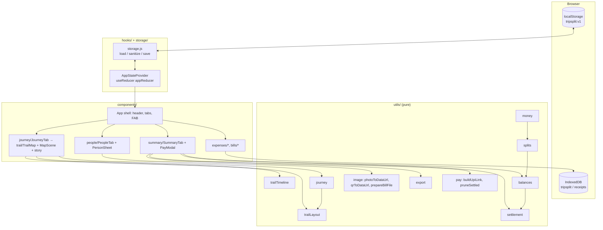
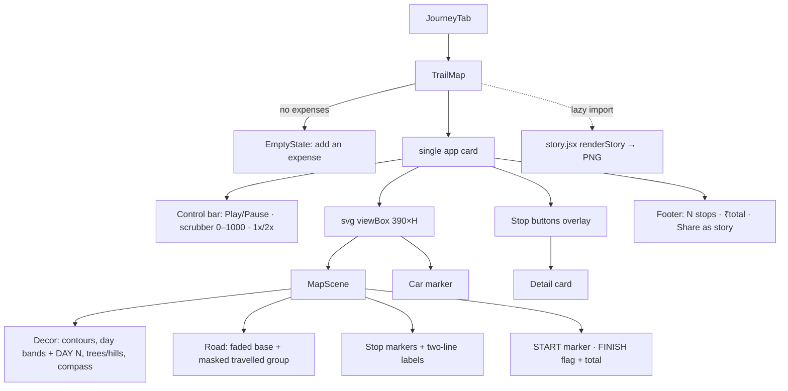
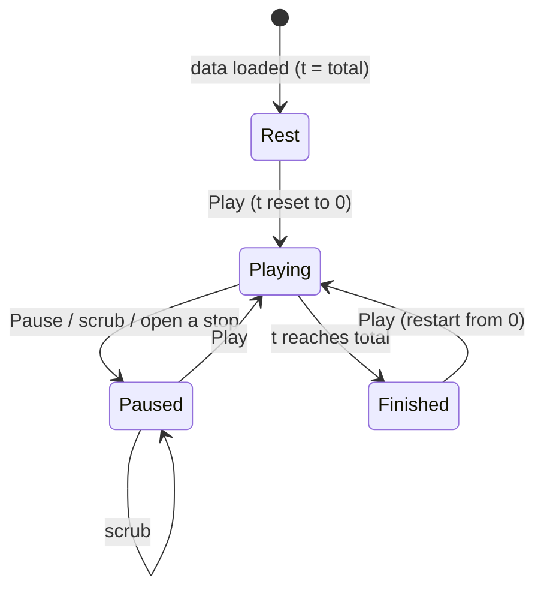

# Design Document

## Overview

TripSplit is a mobile-first, backend-free React app that tracks shared trip expenses and works out who owes whom. All state lives in the browser: app data in localStorage (`tripsplit:v1`), bill files in IndexedDB.

Scope of this document:

- R1–R10: trips, people, expenses, checkbox/custom splits, log, balances and minimum-transfer settle-up, exports, dark mode, persistence, bills. This part is already implemented, and its design is kept here, reorganised into the sections below.
- R11: a redesign of the Journey tab's trail map in a flat "travel poster" style. It supersedes the old paper/river/sticker-scrapbook design.
- R12: an optional Payment QR and a tightened UPI ID per person, a Pay sheet, and paid marks on the settle-up list.

Key design decisions:

| Decision | Rationale |
|---|---|
| All money in integer minor units | No float drift. Shares sum to the amount and nets sum to zero by construction (R6.4, R11.20). |
| Largest-remainder equal split in trip order | Rounding is deterministic and stays the same across edits, because the reducer keeps `participantIds` in trip order. |
| Bitmask DP settle-up for ≤ 15 non-zero people, greedy fallback beyond | Exact minimum number of transfers where that is cheap to compute (R6.3). |
| Pure logic in `src/utils`, React only in `src/components` | Calculations can be unit and property tested without a DOM (R9.2). |
| Payment QR stored inline on the participant | Deleting a participant, a trip or all data removes the QR along with the participant (R12.6). |
| Paid marks keyed by `from\|to\|amount`, pruned on recalculation | Marks survive reloads but never attach to a payment that has changed (R12.14, R12.16). |
| Per-frame playback work goes through refs, not React state | The road reveal and car movement stay smooth. React re-renders only when the number of reached stops changes. |

Stack: React 19 + Vite 8 + Tailwind CSS v4 (JavaScript), with Vitest for tests. Fonts: `@fontsource-variable/inter` for UI and labels, and `@fontsource-variable/space-grotesk` (tabular numerals) for amounts. `@fontsource/caveat` is removed (R11.1).

## Architecture



Data flow:

1. `AppStateProvider` loads the state once with `loadState()`, which runs `sanitizeState`. It then saves on every change with `saveState()` in an effect (R8.1). A `storage` event listener picks up changes made in other tabs.
2. Components dispatch actions. The reducer is the one place that enforces the data invariants: unique names, no orphaned expenses, and split ids kept in participant order.
3. Balances, settlements, journey stops and the trail layout are derived with `useMemo` from the active trip and are never stored. The exception is `trip.settled` (paid marks), which records user intent and is persisted.
4. Bills are written to IndexedDB by id. `pruneOrphanReceipts(state)` runs on load and after deletions (R10.6).

Folder structure:

```
src/
  components/
    App.jsx            shell: header (trip switcher, settings, theme), tab bar, FAB
    expenses/          ExpenseForm, ExpenseLog, ExpenseDetail
    bills/             BillField, BillThumb, BillViewer
    summary/           SummaryTab, PayModal (new, R12)
    people/            PeopleTab, PersonSheet
    journey/           JourneyTab, MoneyMap
    trail/             TrailMap, MapScene, Stickers, story, palette.js, trail.css
    trips/ settings/ ui/ (Modal, ConfirmDialog, Avatar, EmptyState, Icons, Logo)
  hooks/               appReducer, useAppState, useTheme, useToast, useStickers, useReceiptUrl
  storage/             storage.js (localStorage), receipts.js (IndexedDB)
  utils/               money, splits, balances, settlement, journey, trailLayout, trailTimeline,
                       copy, image, pay (new), export, download, dates, id, demoTrip, stickers, svgExport
  test/                *.test.js
```

R11 deletes `trail/SettleCard.jsx`, `trail/Face.jsx`, `trail/Odometer.jsx`, `trail/torn.js`, `trail/Scenery.jsx`, `utils/sound.js` and the `@fontsource/caveat` dependency.

## Components and Interfaces

### Pure function API (`src/utils`)

| Module | Functions |
|---|---|
| `money.js` | `parseAmount(str) → minor \| null` (`'12.5' → 1250`; > 0, ≤ 2 decimals, ≤ `MAX_AMOUNT`), `toMajorString(minor)`, `formatMoney(minor, symbol)` (digit grouping, e.g. `₹18,000`) |
| `splits.js` | `equalSplit(total, ids)`, `describeEqualSplit(total, n) → { count, base, extraCount }`, `computeShares(expense)`, `validateCustomSplit(total, shares, ids) → { valid, sum, difference, error }` |
| `balances.js` | `computeBalances(participants, expenses) → [{ id, name, paid, share, net }]`, `totalExpenditure(expenses)`, `expenseCountFor(id, expenses)` |
| `settlement.js` | `EXACT_LIMIT = 15`, `settleUp(balances) → [{ from, to, amount }]`, `partitionIntoZeroSumGroups(people)` |
| `journey.js` | `buildJourney(trip) → { stops, settlements, finalBalances }`, `personColor(trip, id)` |
| `trailLayout.js` | `layoutTrail(stops, { width, seed })`, `stickerSize(amount, max)`, `smoothPath(pts)`, `rng(seed)` |
| `trailTimeline.js` | `TIMING`, `REDUCED_TIMING`, `buildSchedule(n, timing)`, `reachedAt`, `legAt`, `lengthAt`, `easePan` |
| `copy.js` | `settleKey(s) = "from\|to\|amount"`, `hashSeed`, `wrapText` (quips and badges are no longer used by the trail map) |
| `pay.js` (new) | `toUpiAmount(minor)`, `buildUpiLink(to, amountMinor, tripName)`, `pruneSettled(settled, settlements)` |
| `image.js` | `validateBillFile`, `prepareBillFile`, `photoToDataUrl`, `qrToDataUrl` (new), `fitWithin` (new) |
| `export.js` | `buildLogCsv`, `buildSummaryCsv`, `buildShareText`, `csvEscape` |
| `dates.js` | `toLocalInputValue`, `fromLocalInputValue`, `toLocalDateKey`, `formatDateTime`, `formatDayHeader`, `formatDateRange` |

### Money and rounding (R3, R4, R6.4)

- User input is parsed from a string into integer minor units. Commas and spaces are stripped. More than 2 decimals, zero, and values above `MAX_AMOUNT` are rejected.
- Equal split: `base = floor(total / n)` and `remainder = total − base·n`. The first `remainder` participants in trip order get `base + 1`. `describeEqualSplit` feeds the live preview "Split among N people, ₹X each", which notes when some people pay 1 minor unit more.
- Custom split: every selected person has an integer share ≥ 0, and the shares must sum to the total. Otherwise the form shows `difference` and blocks saving.
- Net = paid − share. Each expense adds `amount` to one person and subtracts shares that sum to `amount`, so the nets always sum to exactly 0.

### Settlement algorithm (R6.3)

1. Take the participants with a non-zero net balance.
2. If there are ≤ 15, a bitmask DP finds the maximum number `k` of disjoint zero-sum groups: `dp[mask] = max over i ∈ mask of dp[mask \ i] + (sum(mask) == 0)`, which is O(2ⁿ·n). The minimum number of transfers is `n − k`. Backtracking gives an ordering whose zero-sum prefixes mark the group boundaries.
3. Within each group, the largest debtor repeatedly pays the largest creditor `min(|debt|, credit)`. Each step zeroes at least one person, so a group of m people needs ≤ m − 1 transfers.
4. If there are more than 15, run the greedy step over the whole set (≤ n − 1 transfers).

### State management

`AppStateProvider` exposes `{ state, dispatch, activeTrip, currency }`. Reducer actions:

- Trips: `ADD_TRIP`, `UPDATE_TRIP`, `DELETE_TRIP`, `SET_ACTIVE_TRIP`, `IMPORT_TRIP` (demo), `RESET`, `REPLACE_STATE`.
- Participants: `ADD_PARTICIPANT`, `UPDATE_PARTICIPANT` (name, photo, upi, qr), `RENAME_PARTICIPANT`, and `REMOVE_PARTICIPANT`, which is refused while `isParticipantUsed`.
- Expenses: `ADD_EXPENSE`, `UPDATE_EXPENSE`, `DELETE_EXPENSE`. `normalizeExpense` puts `participantIds` in trip order.
- Paid marks: `TOGGLE_SETTLED { tripId, key }` and `PRUNE_SETTLED { tripId, settlements }` (new, R12.16).
- Settings: `UPDATE_SETTINGS { patch }`.

### App shell and existing UI (R1–R10)

- Header: trip switcher (select + manage), settings (currency symbol), and dark-mode toggle. Dark mode sets a `.dark` class on `<html>` and uses Tailwind `@custom-variant dark`. It defaults to `prefers-color-scheme`.
- Bottom tab bar: Expenses · Journey · Balances · People. A floating "+" button sits bottom-right above the tab bar on every tab. It opens the expense form in a bottom-sheet `Modal`, or sends the user to add people first when the trip has none (R3.5).
- Expense form:
  - description (auto-focused) and amount (`inputMode="decimal"`)
  - paid by, defaulting to `lastPayerId` or else the first participant
  - date-time, defaulting to now
  - large checkboxes with Select all / Deselect all
  - Equal/Custom toggle with a live preview
  - optional bill field
- Log: newest first, grouped by day, filterable by person (payer or in the split) and by date. Entries can be edited and deleted, with confirmation for deletes.
- Balances tab (`SummaryTab`):
  - stats card
  - Settle up list
  - Balances list: positive green, negative red, with a diverging bar
  - Share & export: copy, native share or a WhatsApp link, and CSV downloads
- Bills (R10):
  - `BillField` offers Take photo and Upload.
  - `validateBillFile` limits images to 20 MB and PDFs to 5 MB. `prepareBillFile` downscales images to a 1600 px JPEG.
  - The file is saved to IndexedDB under `receiptId`. The log shows a `BillThumb`, and `BillViewer` opens the full-size file with download.
  - Deleting an expense, trip or all data deletes the related receipts, and orphaned files are pruned on load.
- Modals (`ui/Modal.jsx`): `role="dialog"` and `aria-modal="true"`. Focus moves into the modal and is trapped there, Escape closes it, and focus returns to the opener.
- Touch targets are at least 44 px, and the UI works at 320 px width.

### R11: Trail map redesign

#### Component tree



#### TrailMap.jsx

Removed from the current file:
- the heading and badges (`tripBadges`)
- the who's-up ticker (`Odometer`, `Face`)
- the person filter chips and `personLine`
- the mute button (`sound.js`)
- `Coin`, the `Hand` tap, `Confetti` and `SettleCard`
- the paper grain, `tornClip` and all `font-hand` classes

Kept: `buildJourney`, `layoutTrail`, `buildSchedule`, the ref-driven loop (`tRef`, `reachedRef`, `lengthsRef`, `applyRef`), follow-scroll while playing, `panTo`, and the lazy `story.jsx` import.

Layout is one `.card` (app zinc styles, `rounded-2xl`) containing, in order:

1. Control bar, the topmost element (R11.2):
   - a `btn-primary` Play/Pause button (`aria-pressed`, "Play trip"/"Pause", `h-11`)
   - a scrubber, `<input type="range" min=0 max=1000 aria-label="Trip position">`
   - a `btn-secondary` speed toggle, `1x`/`2x` (`aria-label="Speed 1x, tap to change"`)

   At 2x the frame delta is doubled, so playback finishes in half the 1x time (R11.16).
2. The SVG map with `role="img"` and `aria-label="Trail map of <trip>: N expenses from start to finish."`. It contains `MapScene` and the car marker.
3. A transparent `<button>` over each stop's marker and label box. Its `aria-label` is "<amount> paid by <full payer name> for <description>. Show shares." and it sets `aria-expanded`. Enter and Space work natively.
4. Footer: `"{N} stops · {money(total)}"` in Space Grotesk tabular, and a `btn-secondary` "Share as story" button.

If `trip.expenses.length === 0`, TrailMap renders an `EmptyState` ("No stops yet. Add an expense to start the trail.") with an Add expense action. No road, stops or controls are rendered (R11.19).

Playback states:



- Rest and Finished: the whole road is drawn at 100%, the faded base is hidden, and the car is hidden (R11.10).
- Playing and Paused: the faded base is at ≤ 40% opacity, and the travelled part (masked) is at 100%. The car sits at `getPointAtLength(L)` (R11.9).
- Reduced motion (`useReducedMotion`):
  - The schedule uses `REDUCED_TIMING` (`travel: 0`).
  - The road is always drawn fully travelled at 100%.
  - The car is placed with no transition and no animation, and there is no pop or pulse.
  - The scrubber calls `apply` synchronously, so the display updates immediately (R11.17).

#### Layout changes (`trailLayout.js`)

Stop positioning is unchanged: sides alternate, spacing uses `GAP`/`DAY_PAD`, jitter is seeded, and the road uses Catmull-Rom `segments`, `days` and `scenery`. What changes:

- Callers pass `title: ''`, `caption: ''`, `debtCount: 0` and `owesLabel: ''`, so the text block has no caption or owes rows.
- `stickerSize(amount, max) = round(50 + 34·sqrt(max(0, amount) / max(1, max)))`, giving a range of [50, 84]. The existing test expectation of `118` becomes `84`, and the "top stop is 30 bigger than stop 5" assertion is reduced to fit the 34-unit range.
- `tilt`, `holder`, `tapeAngle`, `river` and `riverX` are no longer read. Markers are never rotated.
- The layout's `camp` point becomes the FINISH flag position.
- `textX`, `anchor`, `textW`, `amountY` and `paidY` position the two label lines.

Stop order comes from `buildJourney`'s ascending date-time sort. `Array.prototype.sort` is stable, so expenses with identical date-times keep their creation (array) order (R11.22). `day` increments once per distinct local calendar day that has an expense (R11.13).

#### MapScene.jsx (shared by the live map and the story)

Props: `{ layout, trip, stops, pal, reached, landed, idp, live, refs, money, nameOf, reduced, showBase }`.

Road (R11.8–R11.10), with `d = trailStart + ' ' + segments.join(' ')`:
- Faded base, rendered only when `showBase` is true (playing or paused): the same edge, asphalt and lane strokes as below, as a group at opacity 0.35 (≤ 0.4).
- Travelled group with `mask="url(#{idp}-reveal)"`. The mask path uses the same `d`, is white with `stroke-width 22`, and has `stroke-dasharray = pathLen pathLen` and `stroke-dashoffset = pathLen − L`, written per frame through `refs.mask`. The group contains:
  - edge: `pal.edge`, width 17, round caps and joins
  - asphalt: `pal.road`, width 13. This is `refs.trail`, the `getPointAtLength` reference.
  - centre lane: `pal.lane`, width 1.5, `stroke-dasharray="7 7"`
- A hidden `refs.measure` path gives the cumulative length at each stop, as today.
- No river or water path is drawn.

Stop marker (R11.5, R11.6), centred at `(L.x, L.cy)` with radius `L.size / 2`:
- a light disc, `pal.disc`
- a faint scene tint: `SCENE_TINT[scene]` at 35% opacity inside the disc
- a ring: `SCENE_RING[scene]`, stroke width 2
- the icon: existing `Sticker` ART scaled by `0.8 · size / 64` inside a `.stk-art` group. `trail.css` thins the strokes: `.stk-art [stroke-width="2.5"] { stroke-width: 1.7px }` and `.stk-art [stroke-width="2.2"], .stk-art [stroke-width="2"] { stroke-width: 1.5px }`.
- the payer avatar: r = 10 at `(x + 0.36·size, cy + 0.36·size)`, photo or initials on `personColor`, with a 2 px `pal.disc` border
- a dotted connector (`stroke-dasharray 1.5 3`) from the marker bottom to a 3 px road dot at `L.drop`
- no captions, quips, "N people owe" text or mini avatars

Labels (R11.4), at `textX` with `text-anchor = anchor`:
- Line 1: `money(amount)`, Space Grotesk 21 px bold, `tabular-nums`, `pal.text`.
- Line 2: `"PAID BY " + name.toUpperCase()`, Inter 10.5 px at weight 600, `letter-spacing 1.1`, `pal.sub`. The name is passed through `fitLabel(text, textW, charW = 7.2)`, which truncates with `…` so the line never wraps. The SVG text is `aria-hidden`. The full name is in the stop button's `aria-label`.
- Unrevealed stops (`index ≥ reached`) render at 18% opacity.
- The landing stop gets a `.stop-pop` scale (EASINGS.pop, 360 ms) and a single `.stop-pulse` ring (r → r + 14 fading, 700 ms). Neither is rendered under reduced motion.

Decor (R11.11, R11.12). Only these elements are drawn:
- Contour lines: 5–7 seeded closed smooth paths (`rng(hashSeed(seed + ':topo'))`), `pal.text` at 6% opacity, width 1.
- Day bands: `layout.days` rectangles in alternating `pal.band` colours. "DAY N" labels (Inter 10 px, weight 600, letter-spacing 2, `pal.sub`) are drawn only when `layout.days.length > 1`.
- Trees and hills: `layout.scenery` filtered to `pine`, `pine2` and `mountains`, drawn as flat shapes in `pal.tree` and `pal.hill`. `bridge`, `stones`, `bush` and `cloud` are skipped.
- Compass: a small ring with an N arrow at `(W − 34, 34)`, in `pal.sub`.
- START marker at `layout.start`: a small pin, "START" (Inter 10.5/700, letter-spacing 1.4) and "{n} travellers" in `pal.sub`.
- FINISH at `layout.camp`: a checkered flag (a 4×3 grid of `pal.text`/`pal.disc` squares on a pole), "FINISH", and `money(totalExpenditure(trip.expenses))` in Space Grotesk 20 bold (R11.14).

Car marker: a flat `ACCENT` (#D9483B) rounded body with a light window and two dark wheels, about 22×12 units, in `<g ref={carRef}>`. `apply()` sets `translate(p) rotate(angle) scale(flip 1)`. The angle comes from the tangent between `p(L − 2)` and `p(L + 2)`, is clamped to ±26°, and flips with the sign of `dx`, as the current jeep logic does.

#### Palette (`palette.js`)

`HAND` and the scrapbook colour constants are removed. The module exports `ACCENT = '#D9483B'`, `SANS = "'Inter Variable', Inter, ui-sans-serif, system-ui, sans-serif"`, `GROT` (unchanged), `SCENE_TINT` (kept), `SCENE_RING` (new: a saturated twin of each tint) and `trailPalette(dark)`:

| Token | Light | Dark |
|---|---|---|
| `paper` | `#F4F1EA` | `#141A29` (deep navy) |
| `text` | `#1D1D2B` | `#ECEAE4` |
| `sub` | `#6E6B66` | `#98A0B3` |
| `road` | `#26262E` | `#07090F` |
| `edge` | `#FFFDF8` | `#3A4462` |
| `lane` | `#F4F1EA` | `#C7CAD3` |
| `disc` | `#FFFDF8` | `#E9E7E1` |
| `band` | `#EFEBE2` / `#F4F1EA` | `#18202F` / `#141A29` |
| `tree`, `hill` | muted greens, low contrast | desaturated navy-greens |

Contrast (R11.15): labels sit on `paper` or on a band close to it in luminance.

| Pair | Ratio (approx.) |
|---|---|
| `text` on `paper`, light | 15.6:1 |
| `text` on `paper`, dark | 14.5:1 |
| `sub` on `paper`, light | 5.0:1 |
| `sub` on `paper`, dark | 6.9:1 |

These ratios are checked in a unit test (see Testing Strategy).

#### Detail card (R11.7, R11.23)

The detail card is an absolutely positioned `rounded-2xl` card (`bg-white dark:bg-zinc-900`, border, shadow) at 90% width, placed below the stop. It has `role="dialog"` and `aria-labelledby` pointing at its title. It shows:

- the title (description) and a 44 px `×` button (`aria-label="Close"`)
- the amount in Space Grotesk, and "Paid by {payer}" with the app `Avatar`
- one row per split participant from `computeShares(expense)`: Avatar, name, "own share" or "owes {payer}", and `money(share)` right-aligned in tabular numerals. The shares always sum to the amount.

Behaviour:
- Opening a stop pauses playback, sets `openId`, and moves focus to the close button.
- Escape (a document `keydown` listener while the card is open), the `×` button, or a `pointerdown` outside both the card and its stop button closes the card. Closing calls `stopRefs.current.get(openId)?.focus()`.

#### Story export (`story.jsx`, R11.18, R11.24)

`renderStory({ layout, trip, stops, pal, money, nameOf, total }) → Promise<Blob>`:
- Renders a static `<MapScene live={false}>` (road fully travelled, no car) to an SVG string 1080 px wide.
- The header uses Inter: the trip name and "{N} stops · {total}". The FINISH flag carries the total, and there is no settle-up list.
- Embeds `@font-face` rules for Inter and Space Grotesk as base64 (fetched from the bundled font asset URLs) and the `.stk-art` stroke CSS in a `<style>` element.
- Rasterises through `svgExport.js` (Image → canvas → `toBlob('image/png')`).

TrailMap shares the file with `navigator.share({ files })` when `navigator.canShare` allows it, and otherwise downloads it. Any non-Abort error shows `toast('Couldn’t share the story. Please try again.', 'error')`. The export only reads props, so playback refs and `openId` are unchanged.

### R12: Payment QR codes and the Pay flow

#### `utils/image.js`: `qrToDataUrl` and `fitWithin`

```js
export const QR_MAX_SIDE = 720;

/** Pure: longer side ≤ max, aspect preserved, never upscales. */
export function fitWithin(w, h, max = QR_MAX_SIDE) {
  const scale = Math.min(1, max / Math.max(w, h));
  return { w: Math.max(1, Math.round(w * scale)), h: Math.max(1, Math.round(h * scale)) };
}

export class QrError extends Error { constructor(code, message) { super(message); this.code = code; } }

/** @returns {Promise<string>} JPEG data URL */
export async function qrToDataUrl(file, max = QR_MAX_SIDE, quality = 0.92) {
  // 1. !file?.type?.startsWith('image/') → QrError('type',   'That file isn’t an image. Choose a PNG or JPG.')
  // 2. file.size > MAX_INPUT_BYTES (20 MB) → QrError('size',  'That image is too large (max 20 MB).')
  // 3. createImageBitmap(file) throws     → QrError('decode', 'We couldn’t read that image. Try a screenshot.')
  // 4. { w, h } = fitWithin(bitmap.width, bitmap.height, max)
  // 5. canvas w×h, white fill, drawImage, bitmap.close(), return canvas.toDataURL('image/jpeg', quality)
}
```

The checks run in the order type, then size, then decode, so a large file is never decoded (R12.2, R12.3).

#### Storage (`storage.js`)

```js
export const isQr = (v) =>
  isStr(v) && /^data:image\/(jpeg|png|webp);base64,/.test(v) && v.length < 900_000;

/** R12.19: 3–50 chars, exactly one "@" with ≥1 char either side, no whitespace. */
export const isUpi = (v) =>
  isStr(v) && v.length >= 3 && v.length <= 50 && !/\s/.test(v) && /^[^@]+@[^@]+$/.test(v);
```

- `sanitizeTrip` maps each participant to `{ id, name, photo, upi, qr: isQr(p.qr) ? p.qr : null }`.
- A missing, non-string, non-image or oversized `qr` becomes `null`, and the rest of the participant and trip data is kept (R12.5).
- `isUpi` is applied to the trimmed value, both in PersonSheet and in sanitize.
- An older stored UPI ID that fails the new rule loads as `null`. This is safe: the user can re-enter it.

#### Reducer and provider

- `ADD_PARTICIPANT` and `UPDATE_PARTICIPANT` also carry `qr: action.qr ?? null`.
- New `PRUNE_SETTLED { tripId, settlements }` sets `t.settled = pruneSettled(t.settled ?? {}, settlements)`. It returns the same trip object when no key was removed, so it causes no extra save.
- `demoTrip.js` participants get `qr: null`.
- `useAppState` exposes a new `commit(action) → boolean`. It computes `next = appReducer(state, action)` and calls `saveState(next)`. If the save fails it returns `false` and does not dispatch. If it succeeds it dispatches the action, and the effect's second save is harmless. PersonSheet uses `commit` so that a quota failure leaves both the stored and the in-memory state unchanged (R12.21).
- Deleting a participant (`REMOVE_PARTICIPANT`), a trip (`DELETE_TRIP`) or all data (`RESET`) removes the participant object and its inline `qr` with it. No other store holds QR data (R12.6).

#### `utils/pay.js` (new, pure)

```js
import { settleKey } from './copy.js';

/** Minor units → rupees with exactly two decimals, no symbol/separators: 125050 → "1250.50", 100 → "1.00". */
export const toUpiAmount = (minor) => {
  const abs = Math.abs(Math.round(minor));
  return `${Math.floor(abs / 100)}.${String(abs % 100).padStart(2, '0')}`;
};

/** upi://pay?pa=<upi>&pn=<name>&am=<rupees, 2dp>&cu=INR&tn=<note> */
export function buildUpiLink(to, amountMinor, tripName = '') {
  const enc = encodeURIComponent;
  let url = `upi://pay?pa=${enc(to.upi)}&pn=${enc(to.name)}&am=${toUpiAmount(amountMinor)}&cu=INR`;
  if (tripName) url += `&tn=${enc(`TripSplit: ${tripName}`.slice(0, 50))}`;
  return url;
}

/** Keep only the paid marks whose key matches a current settlement payment. */
export function pruneSettled(settled, settlements) {
  const live = new Set(settlements.map(settleKey));
  return Object.fromEntries(Object.entries(settled).filter(([k]) => live.has(k)));
}
```

- `am` uses `toUpiAmount`, not `toMajorString`. `toMajorString` drops `.00` for whole amounts, and R12.11 needs exactly two decimals (R12.11).
- `settleKey` uses the integer minor amount, which is the amount after rounding to two decimals, so keys compare exactly (R12.14).

#### PersonSheet (R12.1–R12.4, R12.19–R12.21)

New local state: `qr` (initialised from `person.qr ?? null`), `qrBusy`, and `errors.qr`. Nothing is written until Save, so Replace or Remove followed by closing the sheet keeps the stored QR (R12.4).

The "Payment QR (optional)" block:
- a hidden `<input type="file" accept="image/*" data-testid="qr-upload">`
- without `qr`: an Upload button (`btn-secondary`, `h-11`)
- with `qr`: a 96 px preview ``, a Replace button (opens the input) and a Remove button (`setQr(null)`)
- a pick calls `qrToDataUrl`. On success it sets `qr` and clears `errors.qr`. On a `QrError` it shows the message in a `<p role="alert" id=…>` referenced by `aria-describedby`, and leaves `qr` as it was. No `alert()` is used.

Save flow:
1. Validate the name (existing rule). Trim the UPI value. If it is non-empty and fails `isUpi`, set `errors.upi = 'That UPI ID isn’t valid. Use a format like name@bank.'` and stop (R12.20).
2. Call `ok = onSave({ name, photo, upi: upi || null, qr })`. PeopleTab calls `commit(UPDATE_PARTICIPANT …)` and returns its boolean.
3. If `!ok`, set `errors.qr = 'Couldn’t save the image. Browser storage is full.'` and keep the sheet open. Otherwise close the sheet.

#### SummaryTab changes (R12.7, R12.13–R12.17)

- `settled = trip.settled ?? {}` and `isPaid = (s) => Boolean(settled[settleKey(s)])`.
- Each settle row gets a trailing "Pay" button: `btn-secondary`, `min-h-11 min-w-11`, the new `QrIcon` and the text "Pay". Its `aria-label` is "Pay {to} {amount}". A ref per row keeps the button for returning focus.
- Paid rows render at `opacity-60`, with a visible "Paid" pill inside the row content (so screen readers read it) and a line-through amount (R12.15).
- `useEffect(() => { if (Object.keys(settled).some((k) => !liveKeys.has(k))) dispatch({ type: 'PRUNE_SETTLED', tripId, settlements }); }, [settlements])` (R12.16).
- Marking a payment paid only touches `trip.settled`. Balances and settlements are derived from expenses and participants alone, so they cannot change (R12.17).

#### PayModal.jsx (new, `components/summary/`)

Props: `{ trip, payment, currency, paid, onToggle, onClose }`. It is built on `ui/Modal`, which provides the dialog role, `aria-modal`, the focus trap, Escape to close and focus return to the Pay button (R12.18).

```
┌ Pay <to> ───────────────────────── × ┐
│ <from> → <to>            [avatar]    │
│              ₹1,250.50               │  formatMoney(amount, currency), same as the row
│ ┌──────────── QR ≥ 240 px ─────────┐ │  or the no-QR message
│ └──────────────────────────────────┘ │
│ [ Open UPI app ]    (₹ and UPI only) │
│ priya@okaxis            [ Copy ]     │  (UPI only)
├──────────────────────────────────────┤
│ [ Mark as paid | Mark as unpaid ]    │
└──────────────────────────────────────┘
```

- QR: a `<button aria-label="Enlarge QR">` wraps `` (R12.9). Tapping it opens a full-viewport overlay (`fixed inset-0 z-[60] bg-black/90`, image `object-contain`). Tapping the overlay or pressing Escape closes it. The Escape handler calls `stopPropagation` in the capture phase so the Pay sheet stays open.
- No QR: "{to.name} hasn’t added a Payment QR yet. You can add one for them in the People tab." (R12.10).
- `currency === '₹' && to.upi`: `<a class="btn-primary" href={buildUpiLink(to, amount, trip.name)}>Open UPI app</a>` (R12.11).
- `to.upi`: `<span class="select-all font-mono">{to.upi}</span>` and a Copy button. The button calls `copyText(to.upi)`, then `toast('UPI ID copied')`, or `toast('Couldn’t copy the UPI ID', 'error')` on failure (R12.12).
- Footer: "Mark as paid" or "Mark as unpaid". `onToggle` dispatches `TOGGLE_SETTLED { tripId, key: settleKey(payment) }`. `paid` is read from the live trip, so the label and the row update immediately (R12.13).

## Data Models

### Persisted state: localStorage key `tripsplit:v1`

```js
{
  version: 1,
  settings: { currency: '₹', theme: 'light' | 'dark' | null },    // currency trimmed, ≤ 4 chars
  activeTripId: string | null,
  trips: [{
    id: string, name: string,
    startDate: 'YYYY-MM-DD' | '', endDate: 'YYYY-MM-DD' | '',
    createdAt: ISO string,
    lastPayerId: string | null,
    participants: [{
      id: string,
      name: string,                    // non-empty, unique per trip (case-insensitive)
      photo: string | null,            // square JPEG data URL, < 300,000 chars
      upi: string | null,              // trimmed; isUpi (R12.19)
      qr: string | null,               // NEW (R12): JPEG data URL, longer side ≤ 720 px, < 900,000 chars
    }],
    expenses: [{
      id: string,
      description: string,
      amount: number,                  // integer minor units, > 0
      paidBy: string,                  // participant id
      dateTime: ISO string,
      splitMode: 'equal' | 'custom',
      participantIds: string[],        // ≥ 1, in trip participant order
      customShares: { [id]: number } | null,   // custom only; integers ≥ 0 summing to amount
      receiptId: string | null,        // IndexedDB key (R10)
    }],
    settled: { [settleKey: 'from|to|amountMinor']: ISO string },   // paid marks (R12.13–R12.16)
  }]
}
```

Validation (`sanitizeState`) drops malformed trips, participants and expenses, and falls back to defaults. For example, an expense whose custom shares don't add up is dropped, and so is an expense whose payer is unknown. A `JSON.parse` failure yields `createInitialState()` (R8.2).

### IndexedDB `tripsplit` → object store `receipts`

The key is `receiptId` and the value is a `Blob` (a JPEG ≤ 1600 px, or the original PDF ≤ 5 MB).

### Derived (never stored)

```js
Balance    = { id, name, paid, share, net }                 // minor units; Σ net = 0
Settlement = { from, to, amount }                           // amount > 0
JourneyStop = { id, index, day, newDay, payerId, amount, description,
                payerShare, debts: Settlement[], running: { [id]: net } }
LaidStop   = { id, index, side: 1 | -1, x, cy, size, hh, top, bottom,
               textX, textW, anchor, amountY, paidY, payer: { x, y, r }, drop: { x, y }, day }
TrailLayout = { width: 390, height, start, camp /* FINISH */, end, stops: LaidStop[],
                days: [{ day, y0, y1, labelLeft }], scenery: [{ type, x, y, s }],
                trailStart, segments: string[] }
Schedule   = { n, arrivals: number[], total, timing }       // ms at 1x
```

### Trail palette

```js
TrailPalette = { dark: boolean, paper, text, sub, road, edge, lane, disc,
                 band: [string, string], tree, hill }
```

## Correctness Properties

*A property is a characteristic or behavior that should hold true across all valid executions of a system-essentially, a formal statement about what the system should do. Properties serve as the bridge between human-readable specifications and machine-verifiable correctness guarantees.*

After reflection, overlapping criteria are merged. 6.1, 6.4, 11.7 and 11.20 share one money property. 8.1 and 12.5 share one round-trip property. 12.13, 12.14 and 12.17 share one paid-mark property. 11.13 and 11.22 share one journey-order property.

### Property 1: Shares sum to the amount and nets sum to zero

For any trip with any participants and any valid expenses (equal or custom split, any amounts and subsets), `computeShares(e)` sums to exactly `e.amount` for every expense. For every participant, `computeBalances` has `net = paid − share`, and the sum of all nets is exactly 0.

**Validates: Requirements 6.1, 6.4, 11.7, 11.20**

### Property 2: Settle-up clears every balance with the minimum number of transfers

For any balance vector of integers summing to zero, applying every `settleUp` payment (`from += amount`, `to −= amount`) brings every net to 0, and every amount is > 0. When at most 15 people have non-zero balance, the number of payments equals `n − k`, where `k` is the maximum number of disjoint zero-sum groups (checked against brute force for n ≤ 8). Otherwise the number of payments is ≤ n − 1.

**Validates: Requirements 6.3, 11.20**

### Property 3: Equal-split preview is consistent

For any total > 0 and count n ≥ 1, `describeEqualSplit(total, n)` satisfies `base·n + extraCount = total` and `0 ≤ extraCount < n`. `equalSplit(total, ids)` gives exactly `extraCount` people `base + 1`, and they are the first `extraCount` ids in order.

**Validates: Requirements 4.3, 6.4**

### Property 4: Custom split validation matches the sum

For any total and any map of non-negative integer shares over a non-empty id list, `validateCustomSplit` is valid if and only if the shares sum to the total, and `difference = total − sum`.

**Validates: Requirements 4.5**

### Property 5: Amount parsing round trip

For any integer `m` with `1 ≤ m ≤ MAX_AMOUNT`, `parseAmount(toMajorString(m)) === m`. For any numeric string with three or more decimal digits, `parseAmount` returns `null`.

**Validates: Requirements 3.1**

### Property 6: Participant name uniqueness and removal guard

For any trip, adding a participant whose name equals an existing name up to case and surrounding whitespace leaves the trip unchanged. For any participant who is a payer or in the split of some expense, `REMOVE_PARTICIPANT` leaves the trip unchanged.

**Validates: Requirements 2.2, 2.3**

### Property 7: State persistence round trip (including Payment QR)

For any well-formed state, including participants with valid `qr` data URLs, UPI IDs and `settled` marks, `parseState(JSON.stringify(state))` deep-equals the state.

**Validates: Requirements 8.1, 12.5, 12.14**

### Property 8: Corrupt input never crashes, and a corrupt QR only nulls the QR

For any arbitrary string, `parseState` returns a well-formed state without throwing. For any otherwise valid state where some participants' `qr` is replaced by an invalid value, sanitizing sets exactly those `qr` fields to `null`. Invalid values include non-strings, non-image data URLs and strings of length ≥ 900,000. All other participant, expense and trip fields stay identical.

**Validates: Requirements 8.2, 12.5**

### Property 9: CSV escaping round trip

For any list of cell strings (including commas, quotes, newlines and non-ASCII), joining `csvEscape(cell)` with commas and parsing with an RFC 4180 parser returns the original cells.

**Validates: Requirements 7.2**

### Property 10: Bill file validation

For any `{ type, size }`, `validateBillFile` returns an error if and only if one of these holds: the type is neither `image/*` nor `application/pdf`, the file is a PDF over 5 MB, or the file is an image over 20 MB.

**Validates: Requirements 10.2**

### Property 11: Journey order and day numbering

For any list of expenses with arbitrary date-times (including duplicates), `buildJourney(trip).stops` is sorted by ascending date-time, and expenses with equal date-times keep their input order. The `day` values start at 1 and increase by exactly 1 at each new local calendar day. The number of distinct days equals the number of distinct local dates, and day labels are shown only when this is greater than 1.

**Validates: Requirements 11.13, 11.22**

### Property 12: Trail layout invariants

For any non-empty list of stops (random amounts, days and ids) and any seed, `layoutTrail`:
- alternates `side` (+1, −1, …)
- places each stop's `top` below the previous stop's `bottom`, with no vertical overlap
- keeps every marker within `[0, width]` horizontally
- keeps every `size` within [50, 84], non-decreasing in amount
- is deterministic: the same input and seed give an identical layout

**Validates: Requirements 11.4, 11.5, 11.22**

### Property 13: Payer label truncation

For any payer name and any label width ≥ 3 characters, `fitLabel` returns a single line (no newline) whose estimated width is at most the available width. It equals the full `"PAID BY NAME"` text when that fits, and otherwise is a prefix of it followed by `…`.

**Validates: Requirements 11.4**

### Property 14: QR scaling bounds

For any image dimensions `w, h ≥ 1`, `fitWithin(w, h, 720)` has a longer side ≤ 720. It equals `(w, h)` exactly when `max(w, h) ≤ 720`. It preserves the aspect ratio: `|out.w − w·s| ≤ 1` and `|out.h − h·s| ≤ 1` with `s = min(1, 720 / max(w, h))`.

**Validates: Requirements 12.3**

### Property 15: QR file rejection reasons

For any `{ type, size }`, `qrToDataUrl` rejects with code `type` when the type does not start with `image/`. Otherwise it rejects with code `size` when `size > 20·1024·1024`. It never decodes a file that fails either check.

**Validates: Requirements 12.2**

### Property 16: UPI ID rule

For any string `s`, `isUpi(s.trim())` equals the reference predicate: `3 ≤ len ≤ 50`, no whitespace, exactly one `@`, and at least one character before and after it.

**Validates: Requirements 12.19**

### Property 17: UPI link parameters

For any UPI ID, recipient name (any Unicode) and amount `m ≥ 1` in minor units, parsing `buildUpiLink({ upi, name }, m, trip)` as a URL gives:
- `pa === upi`
- the decoded `pn === name`
- `am` matching `^\d+\.\d{2}$`, with `Math.round(Number(am)·100) === m`
- `cu === 'INR'`

**Validates: Requirements 12.11**

### Property 18: Paid marks never change money and are isolated per trip

For any state and any settle key in trip A:
- `TOGGLE_SETTLED` applied once flips that key's presence, and applied twice restores the original `settled` map.
- Trip A's expenses, participants, `computeBalances` and `settleUp` results are unchanged.
- Every other trip is unchanged (reference-equal).

**Validates: Requirements 12.13, 12.14, 12.17**

### Property 19: Pruning paid marks

For any `settled` map and any settlements list:
- `pruneSettled(settled, settlements)` keeps exactly those keys of `settled` that equal `settleKey(s)` for some current `s`, with their values unchanged.
- The result is a subset of the input.
- Pruning is idempotent: `pruneSettled(pruneSettled(x, S), S) = pruneSettled(x, S)`.

Consequently, a payment that disappears and later reappears is unpaid.

**Validates: Requirements 12.16**

### Property 20: Deletion removes QR data

For any state and any participant with a `qr`, after `REMOVE_PARTICIPANT` (when the participant is unused), `DELETE_TRIP` of their trip, or `RESET`, the serialised state `JSON.stringify(state)` does not contain that `qr` string.

**Validates: Requirements 12.6**

## Error Handling

| Situation | Handling |
|---|---|
| localStorage missing, unreadable or corrupt JSON | `loadState` / `parseState` catch the error and return `createInitialState()` (R8.2). |
| Malformed trip, participant or expense | `sanitizeState` drops the record or falls back to defaults field by field. A custom split that doesn't sum is dropped so the zero-sum invariant holds. |
| Stored `qr` missing, corrupt or oversized | Set to `null` for that participant only. The rest of the data is kept (R12.5). |
| Old UPI ID fails the tightened rule | Loads as `null`. The user can re-enter it. |
| Save fails (quota / private mode) | `saveState` returns `false` and logs the error. For person edits, `commit()` refuses to dispatch, and PersonSheet shows "Couldn’t save the image. Browser storage is full." (R12.21). |
| Form validation (trip, person, expense, custom split, UPI) | Inline `field-error` messages linked with `aria-describedby`, focus moves to the first invalid field, and nothing is saved. |
| Removing a participant who is in use | The reducer refuses, and the UI explains how many expenses use them (R2.3). |
| Bill file wrong type or too large | `validateBillFile` message shown inline (R10.2). A format that can't be decoded falls back to the original file if it is ≤ 5 MB, otherwise shows an error. |
| IndexedDB unavailable | Bill save or read rejects, and the bill field shows an error. The expense still saves without a bill. |
| QR file not an image, too large, or undecodable | A `QrError` with its code. The message is shown inline beside the field, the previous QR is kept, and no `alert()` is used (R12.2). |
| Clipboard write fails or is unavailable | Toast "Couldn’t copy the UPI ID". The UPI ID stays visible as selectable text (R12.12). |
| `upi://` link with no UPI app installed | The OS handles it. The QR and the copyable UPI ID remain as fallbacks. |
| Story render or share fails | An `AbortError` (user cancelled) is ignored. Anything else shows the toast "Couldn’t share the story. Please try again." Map and playback state are untouched (R11.24). |
| Font embedding for the story fails | The story falls back to system fonts. Rendering continues and is not treated as an error. |
| `getTotalLength` unavailable (e.g. jsdom) | The trail measure effect guards for a missing ref or method. The map renders at rest with the full road. |
| Trip with no expenses | TrailMap shows its empty state, and no playback or measurement runs (R11.19). |

## Testing Strategy

Two kinds of tests are used together. Property-based tests cover the pure logic in `src/utils`, `storage.js` and `appReducer.js`. Example-based unit and component tests cover UI wiring, accessibility and the fixed demo trip.

### Tooling

- Vitest (`npm test` runs `vitest run`, a single run with no watch mode).
- fast-check, added as a pinned devDependency (`"fast-check": "4.3.0"`), for property tests. Properties are not implemented with hand-rolled random loops. The existing randomized settle-up loop in `settlement.test.js` is migrated to fast-check.
- Component tests use `@testing-library/react` and `jsdom` (pinned devDependencies) for the TrailMap, PersonSheet, SummaryTab and PayModal examples. `createImageBitmap`, the canvas, `navigator.clipboard` and `navigator.share` are mocked.

### Property tests

- One `fc.assert(fc.property(...), { numRuns: 100 })` per design property, with at least 100 runs.
- Each test carries a tag comment in the form `// Feature: tripsplit, Property {n}: {property title}`.
- Generators:
  - trips: 1–8 participants with unique names, 0–30 expenses with random amounts from 1 to 10⁷ minor units, non-empty random subsets, equal or valid custom splits (custom shares built by random partition of the amount), and date-times across 1–5 days including duplicates
  - balance vectors: n − 1 random integers plus a balancing last value
  - strings: `fc.string` / `fc.fullUnicodeString`
  - file descriptors: `{ type: fc.constantFrom(...) | fc.string(), size: fc.nat(40MB) }`

| Property | Test file |
|---|---|
| 1, 2, 3, 4 | `balances.test.js`, `settlement.test.js`, `splits.test.js` |
| 5 | `money.test.js` |
| 6, 18, 20 | `reducer.test.js` (new) |
| 7, 8, 16 | `storage.test.js` |
| 9 | `export.test.js` |
| 10, 14, 15 | `image.test.js` |
| 11 | `journey.test.js` |
| 12, 13 | `trail.test.js` |
| 17, 19 | `pay.test.js` (new) |

### Example and unit tests

- Demo trip (R11.21): nets are priya +10,350, naveed +1,150, gautam +300, ashok −1,600, ande −3,750 and ayush −6,450 (major units). `settleUp` returns exactly 5 payments.
- `stickerSize(1800000, 1800000) === 84`, replacing the old `118`.
- Palette contrast (R11.15): a WCAG relative-luminance helper checks `text` and `sub` against `paper` and both `band` colours, in light and dark, at ≥ 4.5:1. It also checks that the dark `paper` is not `#000000`.
- TrailMap render (jsdom):
  - The first focusable element is Play. There is no heading, badge list, ticker, filter group, Settle up text or `font-hand`.
  - Each stop shows exactly two label lines, in the form `₹18,000` and `PAID BY PRIYA`.
  - The road group has edge, asphalt and lane strokes (lane `stroke-dasharray="7 7"`), and there is no river path.
  - "DAY" labels are absent for a single-day trip and are `DAY 1`…`DAY N` for a multi-day trip.
  - FINISH text contains `formatMoney(totalExpenditure)`.
  - A trip with no expenses shows the empty state and no controls.
- Detail card: activating a stop with Enter or Space opens it with one row per split participant, and the rendered shares add up to the amount. Escape, `×` and an outside pointerdown each close it and return focus to that stop's button.
- Reduced motion: with `matchMedia` mocked to `reduce`, the full road renders at opacity 1, no `.stop-pop` or `.stop-pulse` elements appear, and scrubbing updates the scrubber and car transform synchronously.
- Story: when `renderStory` is mocked to reject, an error toast appears and the scrubber value and `openId` are unchanged. The story SVG string contains FINISH and the total, and does not contain "Settle".
- PersonSheet:
  - Upload through `data-testid="qr-upload"` shows a preview with Replace and Remove.
  - A non-image, an oversized file and a decode failure each show the right inline message, and `window.alert` is never called.
  - Closing without saving keeps `person.qr`.
  - An invalid UPI ID blocks save with an inline error.
  - A `commit` returning `false` shows the storage error and keeps the old QR.
- SummaryTab and PayModal:
  - Every row has a Pay button.
  - The sheet shows `from → to` and the same formatted amount as the row.
  - With a QR, the image has the correct alt text and enlarges on tap, and Escape returns to the sheet.
  - Without a QR, the People tab message is shown.
  - "Open UPI app" is present only for ₹ with a UPI ID, and its `href` equals `buildUpiLink(...)`.
  - Copy success and failure show their toasts.
  - Mark as paid toggles the label and the row's "Paid" text without a reload.
  - Editing an expense so that a payment changes removes the stale mark (PRUNE_SETTLED).
- Dependency smoke test: `package.json` has no `@fontsource/caveat`, and there are no imports of the deleted trail files or `sound.js` (a `grep`-style test over `src/`).

### Manual checks

- Touch targets are at least 44 px, and the UI works at 320 px width (R9.1). Visual check of the poster style in light and dark themes.
- Screen reader pass (VoiceOver/TalkBack) over stops, the detail card and the Pay sheet. Full WCAG conformance needs manual testing with assistive technologies and an expert review. Automated contrast checks cover only the palette pairs.
